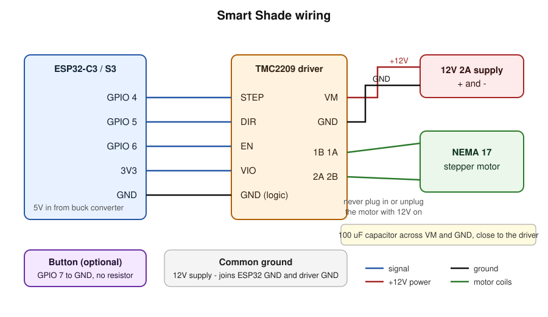

# Smart Shade

Motorize a bead-chain (chain loop) window shade and control it from your phone. An ESP32 drives a stepper motor that turns the chain. You open, close, or set the shade to any percentage from a web app on your phone, and it opens and closes on its own on schedules you set, including at sunrise and sunset.



## Features

- **Phone app, no app store.** The ESP32 serves the app at `http://shade.local`. In Safari, use Share > Add to Home Screen.
- **Control:** open, close, stop, a 0 to 100% slider, and 25/50/75% presets.
- **Schedules:** up to 16, stored on the ESP32 so they run even if your phone is off. Each fires at a clock time, at sunrise, or at sunset (with an offset), on the weekdays you choose.
- **Automatic timezone and daylight saving.** The app copies your phone's timezone to the shade, and the shade switches clocks by itself. 100+ zones are built in.
- **Calibration** from the app: jog to fully open, set; jog to fully closed, set.
- **Smooth, quiet motion.** Hardware-timed step pulses with acceleration, and the motor is released when idle. The position is saved so it survives power loss.
- **WiFi setup from your phone.** No WiFi password is ever written in the code.
- **Optional physical button** to open/close or stop.

## Hardware

| Part | Notes |
|---|---|
| ESP32-C3 or ESP32-S3 dev board | any ESP32 with WiFi works |
| NEMA 17 stepper motor | about 0.4 to 0.5 N·m for most shades, e.g. 17HS4401 |
| TMC2209 stepper driver module | near-silent; used in standard STEP/DIR mode |
| 12V 2A DC power supply | powers the motor |
| 12V to 5V buck converter | powers the ESP32 (or use a separate 5V USB supply) |
| 100 µF electrolytic capacitor | across the driver's VM and GND |
| Chain sprocket | sized to your bead chain (bead diameter is commonly 4.5 or 6 mm), 3D-printed or bought |
| Momentary button (optional) | GPIO 7 to GND |

Wiring is in the diagram above. Pins are set at the top of `main/main.c`: STEP = GPIO 4, DIR = GPIO 5, EN = GPIO 6 (active low), button = GPIO 7.

Notes:
- Never connect or disconnect the motor while the 12V is on. It can destroy the driver.
- Set the driver current to about 0.8 to 1.0 A for a 1.5 A motor (the small VREF potentiometer on most modules). Start low and raise it only if the motor skips.
- With the TMC2209's default 1/8 microstepping, a 200-step motor needs 1600 steps per revolution.

## Build and flash

Two versions of the firmware are included. They do the same thing.

**C (ESP-IDF), the main version.** Requires ESP-IDF 5.2 or newer.

```
. $IDF_PATH/export.sh
idf.py set-target esp32c3        # or esp32s3
idf.py build flash monitor
```

In VS Code, install the "Espressif IDF" extension, open this folder, and use the build/flash buttons in the bottom bar. The first build downloads the mDNS component automatically.

**Arduino / PlatformIO.** See [`arduino/README.md`](arduino/README.md).

## First run

1. Join the `SmartShade-Setup` WiFi network on your phone and open `http://192.168.4.1`. Pick your WiFi and enter its password. The controller reboots and joins your network. (There is no automatic popup, so type the address in the browser.)
2. Open `http://shade.local` in Safari, then Share > Add to Home Screen.
3. Settings > Calibration: jog to fully open and press *Set open here*, then jog to fully closed and press *Set closed here*. If the shade moves the wrong way, switch on *Reverse motor direction*.
4. The timezone sets itself from your phone. Enter your latitude and longitude if you want sunrise/sunset schedules, then add schedules in the Schedules tab.

## How it works

- **Position** is counted in motor steps: 0 is fully open and the calibrated maximum is fully closed. It is saved after every move.
- **Step pulses** come from a 1 MHz hardware timer interrupt with an integer trapezoid speed ramp (`main/stepper.c`), so WiFi and web requests cannot make the motor stutter. Reversing mid-move brakes first, then turns around.
- **Time.** The clock syncs over the internet (NTP). The ESP32 holds the daylight-saving rule for your zone. Schedules inside the hour skipped by "spring forward" fire right after the jump, and "fall back" never fires a schedule twice.
- **Canada.** British Columbia, Alberta, Manitoba and the Northwest Territories stop changing their clocks on 1 Nov 2026 (permanent daylight time) and are set up that way. Zones are checked against the IANA database through the end of 2027. Governments change DST rules, so a future firmware update may be needed.

## Project layout

```
main/main.c            WiFi, web server and API, schedules, storage, button
main/stepper.c/.h      timer-driven step/dir driver with acceleration
main/sun.c/.h          sunrise and sunset calculation
main/index.html        the phone web app (embedded into the firmware at build time)
sdkconfig.defaults     build settings
arduino/               the same controller as an Arduino/PlatformIO sketch
docs/wiring.svg        wiring diagram
```

## API

For Shortcuts, Home Assistant, or your own app. Everything is under `http://shade.local/api`.

| Method | Path | Purpose |
|---|---|---|
| GET | `/state` | position, percent open, moving, time, sunrise/sunset |
| POST | `/move?percent=0..100` | go to a percent open |
| POST | `/stop` | stop |
| POST | `/jog?steps=N` | relative move (for calibration) |
| POST | `/cal/open`, `/cal/closed` | set the limits |
| GET/POST | `/schedules` | list or replace schedules (JSON array) |
| GET/POST | `/settings` | speed, acceleration, direction, timezone, location |

## Security

There is **no login** on the web app or API. Anyone on your WiFi network can control the shade. That is fine on a home network, but do not expose the shade directly to the internet. For remote access, use a VPN such as Tailscale.

## Status

This is a first version. The sunrise/sunset math and the motor speed ramp were tested on a PC, but the full firmware has not been verified on real hardware yet, so expect to tune speed, acceleration and driver current on your own motor. Issues and pull requests are welcome.

## License

[MIT](LICENSE)

Planned: a login for the API, outside-the-house access, HomeKit/Siri, a light sensor, and limit switches.
